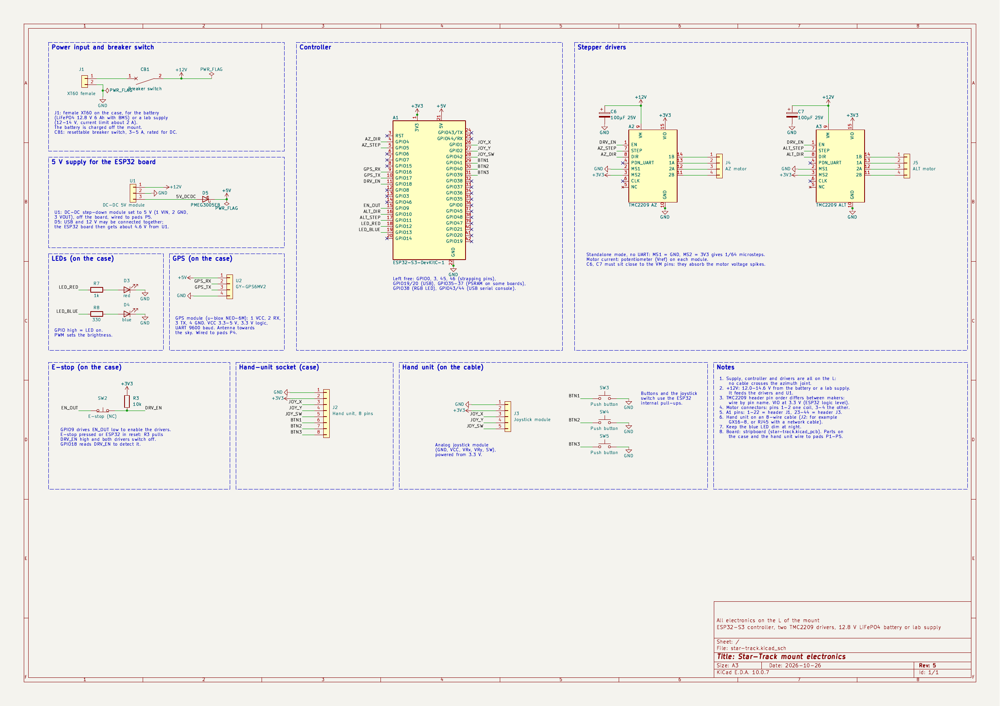
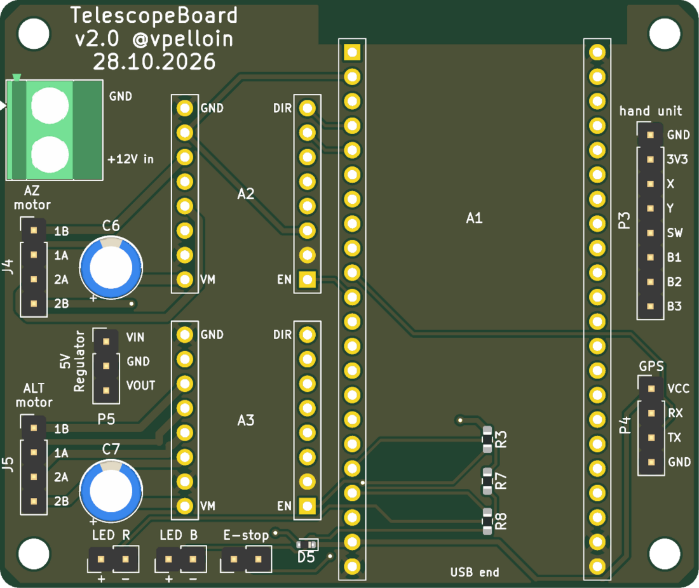
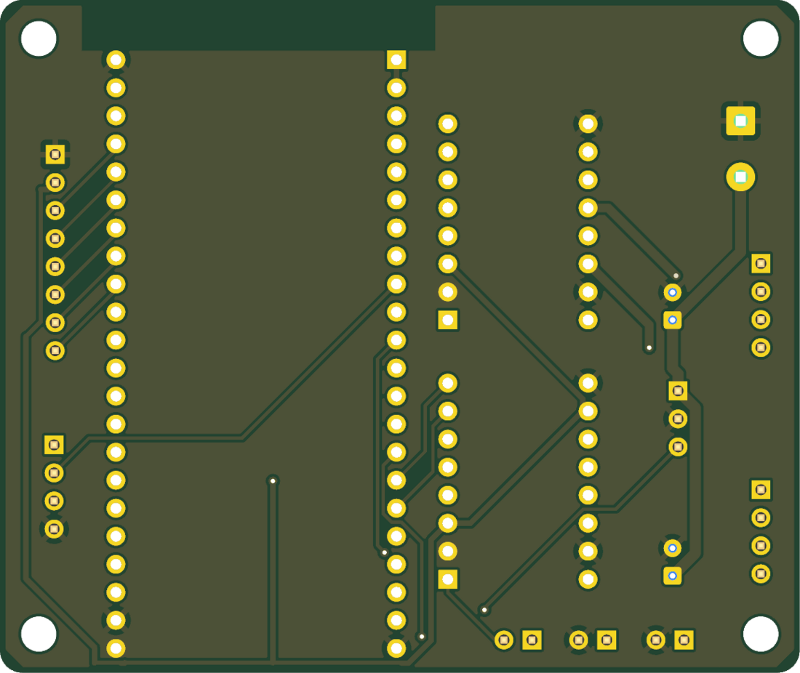
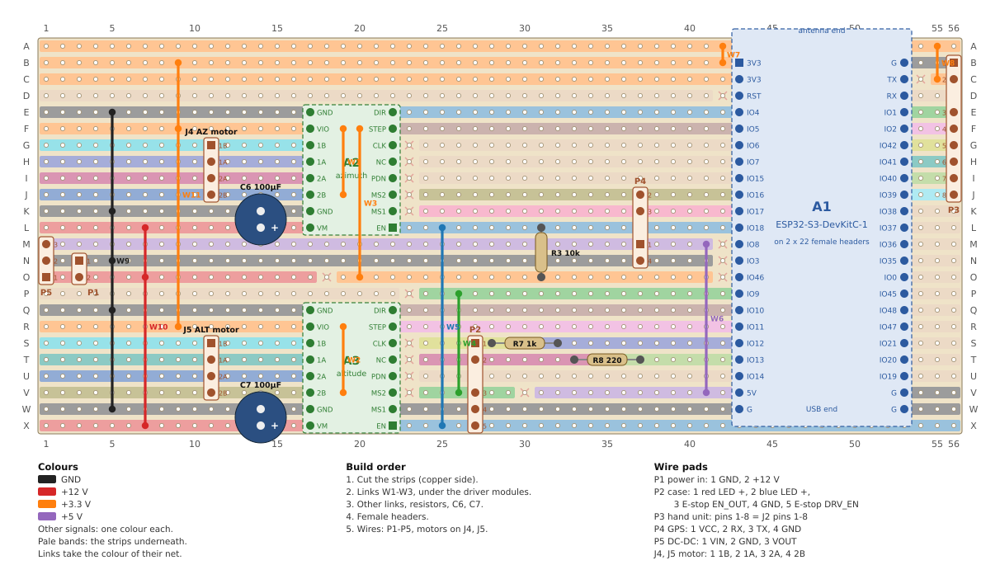
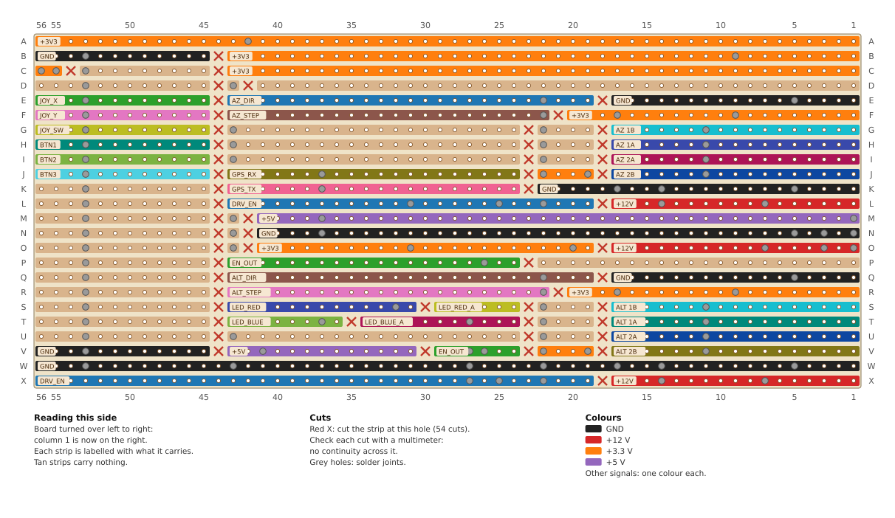

# Architecture (planned)

Status: design notes. Nothing below is implemented yet.

## Requirements

- Point at and track sky objects with an alt-azimuth mount (goto + tracking).
- Control from an iPhone without publishing an app to the App Store.
- Work in places without Wi-Fi infrastructure or mobile network.
- Manual control and initialisation with a joystick, buttons and an emergency stop.

## Controller

A single **ESP32-S3** runs the whole mount. The Orange Pi 3 LTS is not used.

Reasons:

- Step pulses are generated by hardware peripherals (RMT/MCPWM, for example with the
  FastAccelStepper library) instead of Linux user-space timing, which was the main
  problem in `v1` (`nanosleep` jitter, CPU pinning).
- Boots in under a second, has no SD card to corrupt when power is cut.
- Built-in Wi-Fi access point, so no external network is needed.
- One board to power and wire.

```
 iPhone            ┌──────────── ESP32-S3 (standalone) ────────────────────────────┐
 (home-screen ◄──► │ Wi-Fi access point                                            │
  web app)         │   HTTP: serves the web app (gzipped, from flash)              │
                   │   WebSocket: commands in, ~10 Hz status out                   │
 joystick,  ─────► │ Motion: clock → RA/Dec → alt/az → alignment model → steps     │
 buttons, E-stop   │ Persistent settings (NVS): site, alignment, axis config       │
                   └──────┬───────────────┬────────────────────────────────────────┘
                     Az driver       Alt driver
```

The phone is only a remote: the mount keeps its own clock and does the tracking
calculations, so tracking continues when the phone is locked or disconnected.

## Phone interface

- A web app served by the ESP32 over its own access point (for example
  `http://192.168.4.1`, optionally an mDNS name), installed with Safari's
  *Add to Home Screen*. No App Store account and no 7-day re-signing (unlike
  AltStore or free provisioning, used in `v2`).
- Plain HTTP. On iOS Safari, the Geolocation API and service workers require a
  secure context, so they are not available. Neither is needed:
  - time: the phone sends its clock (`Date.now()`) on each connection;
  - location: saved sites or manual entry; town-level accuracy is enough because
    the star alignment absorbs location errors;
  - offline use: the app is always loaded from the mount itself.
- Astronomy in the web app: [Astronomy Engine](https://github.com/cosinekitty/astronomy)
  (MIT licence, about 1′ accuracy) for Sun, Moon, planets and precession, plus a
  static catalogue (Messier, bright NGC objects, named stars).
- Web Bluetooth is not available in iOS Safari, so the link is Wi-Fi.
- Red night-vision theme.
- Possible later: a subset of the LX200 protocol over TCP so that SkySafari or
  Stellarium can also drive the mount.

## Firmware

- Framework: PlatformIO with the Arduino core 3.x (built on ESP-IDF 5), for
  FastAccelStepper and an async web server. Note: `server/main/main.c`
  in `v3` declares an Arduino `WiFiServer` inside an ESP-IDF project and does not
  compile as is.
- Modes: E-STOP → IDLE → MANUAL / GOTO / TRACKING / PARKED.
- Tracking loop at about 20 Hz: motor speed = predicted rate + k × position error
  (repeated `moveTo` calls would ramp up and down).
- Targets:
  - stars and deep-sky objects: fixed RA/Dec of date;
  - Moon and planets: a table of positions (for example every 10 minutes for the
    next hours) sent by the phone and interpolated by the mount. The Moon's
    topocentric parallax makes linear extrapolation drift.
- Alignment: 2–3 stars with Taki's matrix method (absorbs a base that is not level
  and an unknown north). Requires a known altitude zero (tube level at power-on or a
  home switch). A sync after each goto improves local accuracy.
- One JSON message set for WebSocket and serial: `set_time`, `set_site`, `goto`,
  `track`, `jog {x, y}`, `stop`, `align_add`, `sync`, `park`.
- Safety:
  - jog commands expire after about 200 ms if not repeated (dead-man);
  - losing the phone connection stops manual motion, not tracking;
  - software limits for altitude. Azimuth needs no cable-wrap limit, because no
    cable crosses the azimuth joint (see [Power](#power)).

## Electrical

Schematic: [`electronics/star-track.pdf`](../electronics/star-track.pdf) (KiCad
project in [`electronics/`](../electronics/)). No touch screen: the phone is the
display, and two LEDs on the case give feedback at the mount.



### Printed circuit board

Board: [`electronics/star-track.kicad_pcb`](../electronics/star-track.kicad_pcb), to be
made by a PCB service (for example JLCPCB).

- 72 × 61 mm, two layers, rounded corners, four M3 mounting holes. All text on the
  top silkscreen, at least 0.15 mm strokes.
- Through-hole parts, except R3, R7, R8 (0603, hand-soldering pads) and D5
  (SOD-523), on the top side.
- Laid out by function:
  - left edge, from the top: the power input (P1, a 5.08 mm screw terminal, for
    example Dinkle EK508V-02P), the azimuth motor wires (J4), the DC-DC converter
    (P5) and the altitude motor wires (J5);
  - middle: the two drivers, logic pins towards the ESP32, with C6 and C7 beside
    their VM and GND pins (about 8 mm of track to VM);
  - right: the ESP32 board (headers 25.4 mm apart, measured), antenna over the top
    edge. R3, R7 and R8 sit under it, next to the pins they serve. Solder them
    before the ESP32 board's headers;
  - right edge: the hand unit (P3, in J2 order) and the GPS module (P4, in its pin
    order);
  - bottom edge: one pair of pads per part on the case: red LED (P2) and blue LED
    (P6), each with its own GND, and the E-stop (P7), then D5. The E-stop is a contact between
    EN_OUT and DRV_EN, without GND.
- Every pad is labelled on the silkscreen. EN, DIR, VM and GND mark the corner pins
  of each driver socket, and "USB end" the ESP32 board's USB end, so the modules go
  in the right way round.
- Track widths by net class: 1.0 mm for +12 V and GND, 0.8 mm for the motor coils,
  0.5 mm for +5 V and +3.3 V, 0.3 mm for signals and the DC-DC output. Narrower
  where a track passes between two header pins.
- Routed with Freerouting, then a GND fill on both layers. A keep-out under the
  ESP32 board's antenna has no copper on either layer: no tracks, vias or fill.
- KiCad's DRC passes with no errors and no unconnected pads (one warning: the
  terminal's outline reaches the board edge).
- Gerber and drill files for ordering:
  [`electronics/star-track-gerbers.zip`](../electronics/star-track-gerbers.zip),
  exported from the board. At JLCPCB: upload the zip, 2 layers, 1.6 mm.





### Stripboard

An alternative to the printed board:
[`electronics/stripboard/stripboard.kicad_pcb`](../electronics/stripboard/stripboard.kicad_pcb),
a 24 × 56 hole stripboard (2.54 mm pitch, strips along the 56-hole length). The strips
are copper tracks in KiCad, cut where needed, and the wire links are board-only parts
whose pads count as joined, so KiCad's DRC checks the board against the schematic.
Columns 1–56 run from the left and rows A–X from the top, seen from the component side.





- 54 strip cuts and 11 wire links. W9–W11 are bus wires soldered at several holes
  (GND, +12 V, +3.3 V).
- The ESP32 board and the two driver modules sit on female headers. W1–W3 run under
  the driver modules: fit them before the headers.
- The ESP32 board's headers are taken as 25.4 mm apart. Some drawings give 22.86 mm:
  measure the board first. Its antenna end overhangs the top edge by a few millimetres.
- No D5: the USB rules in [Power](#power) apply.
- Motors: the cables are soldered into J4, J5 (1B, 1A, 2A, 2B from the top), on the
  same strips as the driver outputs. A 1×4 pin header also fits there.
- Wires to the case, the hand unit and the modules off the board:
  - P1: power in from CB1 and J1;
  - P2: LEDs and E-stop;
  - P3: hand-unit socket J2, pins 1–8 in J2 order;
  - P4: GPS module, numbered as its pins (1 VCC, 2 RX, 3 TX, 4 GND);
  - P5: DC-DC converter, numbered as U1's pins (1 VIN, 2 GND, 3 VOUT).
- Check every cut with a multimeter before fitting the modules, and check the driver
  pin order against the module.

### Emergency stop (works without firmware)

For drivers with an active-low enable input (A4988, DRV8825, TMC2209):

```
GPIO9 EN_OUT (LOW = enable) ───[E-stop, NC contact]──┬── DRV_EN: EN of both drivers
                                                      ├── 10 kΩ pull-up to 3.3 V
                                                      └── GPIO18 (reads DRV_EN)
```

- Pressed: the contact opens, EN is pulled high, the drivers switch off.
- ESP32 reset: the output floats, the pull-up also switches the drivers off.
- The firmware reads EN high while driving it low, so it knows the E-stop was
  pressed and requires re-arming.
- Cutting the motor supply instead can damage the drivers.
- With the drivers off the motors have no holding torque: the tube must be
  balanced, and the position should be treated as uncertain until re-synced.
- The 10 kΩ pull-up is needed: without it, an open E-stop leaves EN floating and
  the drivers may stay on.

### Drivers

- TMC2209 modules (StepStick format) in standalone mode: only STEP, DIR and EN
  from the ESP32, no UART.
- MS1 to GND and MS2 to 3.3 V select 1/64 microsteps (interpolated to 1/256 for
  smooth motion). The table differs from the TMC2208's: check it in the TMC2209
  datasheet.
- Motor current: set with the potentiometer (Vref) on each module, measured with a
  multimeter as the module maker describes.
- Logic supply (VIO) at 3.3 V, the ESP32's logic level. PDN_UART, CLK and the spare
  pin stay unconnected.
- 100 µF at each module's VM pin is required: it absorbs the voltage spikes from
  the motor coils, which can otherwise destroy the driver.
- The header pin order differs between module makers: wire by pin name.

### Pins

The schematic assumes an ESP32-S3-DevKitC-1. The pin choice follows the stripboard:
each driver's STEP and DIR pins share strips with their ESP32 pins, and the
hand-unit pins are next to each other on header J3.

| GPIO | Use |
| --- | --- |
| 1, 2 | Joystick X, Y (ADC1) |
| 4, 5 | Azimuth DIR, STEP |
| 9 | EN_OUT, through the E-stop to the drivers' EN |
| 16, 17 | GPS: UART TX to the module's RX, UART RX from its TX |
| 10, 11 | Altitude DIR, STEP |
| 12, 13 | Red LED, blue LED |
| 18 | Reads DRV_EN (E-stop detection) |
| 42 | Joystick switch |
| 41, 40, 39 | Buttons 1–3 |

- Analog inputs on ADC1 (GPIO1–10): ADC2 is shared with Wi-Fi.
- Left free: strapping pins (0, 3, 45, 46), USB (19, 20), the USB serial console
  (43, 44), the RGB LED (38), and flash/PSRAM pins (26–32, plus 33–37 on modules
  with octal PSRAM).
- Spare: GPIO6, 7, 8, 14, 15, 21, 47, 48.
- Buttons and the joystick switch connect to GND and use the internal pull-ups.

### Hand unit

- The joystick and the three buttons are in a hand-held unit, not on the mount.
- It connects to an 8-pin socket on the case through an 8-wire cable: GND, 3.3 V,
  joystick X, Y and switch, buttons 1–3. For example a GX16-8 aviation connector,
  or RJ45 with a network cable.
- The E-stop stays on the case.

### GPS

- A GY-GPS6MV2 module (u-blox NEO-6M) gives the time and the site, so the mount
  needs neither from the phone. The phone's `set_time` and `set_site` stay as a
  fallback, for example indoors.
- Off the board, with its antenna towards the sky: on top of the case. Four wires
  to P4.
- Powered from 5 V (the module has its own 3.3 V regulator, and accepts 3.3–5 V),
  3.3 V logic on the UART: it connects to the ESP32 directly. NMEA at 9600 baud by
  default. About 45 mA.

### Feedback: LEDs

- LEDs: red on GPIO12 (1 kΩ), blue on GPIO13 (330 Ω), both to GND.
  - About 1–3 mA each, and PWM sets the brightness.
  - Blue light spoils dark adaptation more than red: keep the blue LED dim, or use
    it only during setup.
- Possible uses: LED patterns for Wi-Fi client connected, tracking, and E-stop.

### Power

The battery and all the electronics are on the L, which carries the motors too.
No cable crosses the azimuth joint, so the head can turn round any number of
times.

| Item | Choice |
| --- | --- |
| Input | Female XT60 socket on the case. |
| Battery | LiFePO4 12.8 V (4 cells in series), 6 Ah (about 77 Wh), with a built-in BMS, on a male XT60 lead. |
| Before the battery | A lab supply plugs into the same socket with an XT60 cable: 12–14 V, current limit about 2 A. |
| Charging | At home, off the mount, with a 12 V car battery charger (see below). No charging circuit on the mount. |
| Switch and protection | A resettable breaker switch (3–5 A, rated for DC) right after the XT60 socket: it is both the main switch and the fuse. |
| Motor supply | The switched rail (12.0–14.6 V) goes straight to the drivers' VM pins, with 100 µF at each. |
| 5 V | DC-DC step-down module set to 5 V, through the Schottky diode D5 into the ESP32 board's 5V pin. The GPS is on the 5V pin side of D5. |
| 3.3 V | The regulator on the ESP32 board. It also supplies the drivers' logic and the joystick. |

- Breaker switch: thermal breakers trip after a few seconds at 2–3 times their
  rating. That protects the wiring. Short circuits are cut faster by the battery's
  BMS or the lab supply's current limit.
- USB and the 12 V supply: Espressif lists the board's USB ports, its 5V pin and
  its 3V3 pin as mutually exclusive power inputs. D5 (PMEG3005EB, 30 V 0.5 A,
  anode at U1) stops USB power from flowing back into U1:
  - on the PCB, USB and the 12 V supply may be connected at the same time, for
    example a serial monitor while the motors run. The ESP32 board then gets about
    4.6 V from U1, and the GPS runs from USB alone too;
  - the ESP32 board and the GPS draw about 0.2 A, with peaks near 0.35 A when Wi-Fi
    transmits: within D5's rating;
  - on the stripboard (no D5): breaker on, keep the ESP32 board's USB unplugged; USB
    plugged in, keep the breaker off. With the mount powered, use Wi-Fi for logs
    (WebSocket) and firmware updates (OTA).

Charging LiFePO4 with a car (lead-acid) charger:

- A LiFePO4 battery is full at 14.4–14.6 V. A normal 12 V lead-acid charge (about
  14.4 V, then about 13.6 V float) suits it, and the BMS cuts off above its limit.
- If the charger has a lithium or LiFePO4 mode, use it.
- Do not use desulfation, recondition or repair modes: they raise the voltage above
  15 V.
- Some chargers do not start on a battery whose BMS has switched off after a deep
  discharge.
- Batteries sold with an XT60 often have the female side fitted. With a female
  socket on the case, such a battery needs a male lead or an adapter.

DC-DC converter (U1):

- A small step-down module set to 5 V. It sits off the board, on three wires to P5
  (VIN, GND, VOUT).
- Its input range must cover 12.0–14.6 V. Check the output with a multimeter before
  connecting the ESP32 board.
- Compared with a linear L7805, it saves about 1 W, roughly an hour of runtime.

Budget (estimates, not measured):

| Load | Current from the battery |
| --- | --- |
| ESP32-S3 with the access point on (0.10–0.15 A at 5 V, through the DC-DC converter) | 0.04–0.07 A |
| GPS (about 45 mA at 5 V) | about 0.02 A |
| Two motors while tracking (current set with the potentiometers) | 0.2–0.3 A |
| LEDs | a few mA |
| Total | about 0.3–0.4 A, about 3.5–5 W |

At 0.4 A, using about 5 Ah of the 6 Ah, that gives about 12 h. A lower motor
current gives more. Slews draw more, but only for a few seconds.

### Placement

- Battery: at the far end of the 380 bar, opposite the arm, in a printed cradle
  (see [mechanics](mechanics.md#battery)). Until it is bought, a lab supply on the
  bench.
- Case (printed, about 130 × 90 × 50 in the model):
  - low on the outer face of the arm;
  - holds the stripboard (ESP32 board, both drivers), the DC-DC
    converter and the breaker switch;
  - on its face: the E-stop and the two LEDs; on top: the GPS module;
  - underneath: the XT60 socket and the hand-unit socket.
- The joystick and buttons are in the hand unit, on its cable.
- The battery cable runs along the side of the bar and up the arm. The motor cables
  stay on the L.

### Parts list

Electronics only. The battery, its XT60 lead and the motor cables are in
[Power](#power) and [mechanics](mechanics.md).

On the board (PCB or stripboard):

| Ref | Part | Qty |
| --- | --- | --- |
| A1 | ESP32-S3-DevKitC-1 | 1 |
| A2, A3 | TMC2209 driver module, StepStick format | 2 |
| C6, C7 | 100 µF 25 V electrolytic capacitor, Ø6.3 mm, 2.5 mm lead spacing | 2 |
| R3 | 10 kΩ resistor: 0603 on the PCB, 0.25 W through-hole on the stripboard | 1 |
| R7 | 1 kΩ resistor: 0603 on the PCB, 0.25 W through-hole on the stripboard | 1 |
| R8 | 330 Ω resistor: 0603 on the PCB, 0.25 W through-hole on the stripboard | 1 |
| D5 | Schottky diode PMEG3005EB, SOD-523 (PCB only) | 1 |
| – | 1×22 female header (ESP32 board) | 2 |
| – | 1×8 female header (driver modules) | 4 |
| – | The PCB, or a stripboard of 24 × 56 holes | 1 |
| – | Tinned copper wire (bus links W9–W11), insulated hook-up wire (other links) | – |
| P1–P5, J4, J5 | Wire pads: wires soldered in, or pin headers (P2, P3 and P4 have a gap, for a pulled pin) | optional |

On the case:

| Ref | Part | Qty |
| --- | --- | --- |
| J1 | XT60 female, panel mount | 1 |
| CB1 | Resettable breaker switch, 3–5 A, rated for DC | 1 |
| U1 | DC-DC step-down module, set to 5 V, input range up to at least 14.6 V | 1 |
| U2 | GPS module GY-GPS6MV2 (u-blox NEO-6M), with its antenna | 1 |
| D3, D4 | LED, red and blue, with panel holders | 2 |
| SW2 | E-stop, NC contact | 1 |
| J2 | 8-pin socket (GX16-8, or RJ45) | 1 |

Hand unit:

| Ref | Part | Qty |
| --- | --- | --- |
| J3 | Analog joystick module (GND, VCC, VRx, VRy, SW) | 1 |
| SW3–SW5 | Push button | 3 |
| – | 8-wire cable and the plug that matches J2 | 1 |

### Left out

Left out to keep the circuit simple. Each can be added later without other changes.

| Part | What it adds |
| --- | --- |
| 470 µF on the 12 V rail | More buffering, if the supply wires are long. |
| 100 kΩ / 22 kΩ divider (and 100 nF) from 12 V to GPIO6 | Battery voltage, for a low-battery warning before the BMS cuts the power. |
| 1 kΩ from GPIO15 to the drivers' PDN_UART pins, GPIO7 direct | Driver configuration over UART: current and microsteps from the firmware, MS1/MS2 then set the addresses. |
| 100 nF on joystick X and Y | Less noise picked up by the cable. Averaging readings in the firmware does the same. |

## Drive resolution

- `v1` constants: 200 steps/rev × 1/16 microstepping × 20:250 pulleys give
  32.4″ per microstep, so one microstep about every 2 s at sidereal rate.
- Target ≤ ~8″ per microstep. At 1/64 (the TMC2209 setting above), the existing
  20:250 pulleys give 8.1″ per microstep, one microstep about every 0.5 s at
  sidereal rate.
- An extra 20→80 belt stage (50:1 overall) would also reach 8.1″ at 1/16, and adds
  torque and stiffness.
- The torsional stiffness of the drive seen at the telescope grows with the square
  of the reduction ratio.

## Open points

- Exact stepper motors (rated current) and driver module make (header pin order).
- Exact DC-DC converter (input range, output ripple).
- Joystick type (analog or switches) and E-stop contact type (NC needed).
- Hand-unit connector.
- Exact ESP32-S3 board (flash and PSRAM size). The schematic uses the
  ESP32-S3-DevKitC-1 pinout.
- Exact battery (its size sets the cradle) and case.
- Case size: the stripboard (about 145 × 62 mm) is larger than the 130 × 90 case in
  the model.
- Measured current draw, to confirm the runtime estimate.
