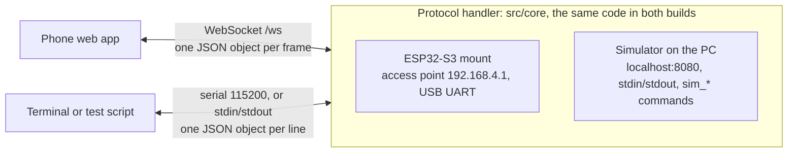
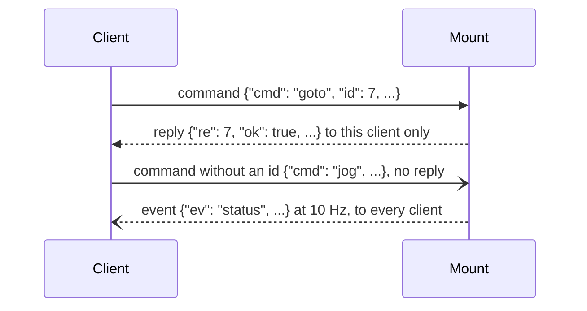
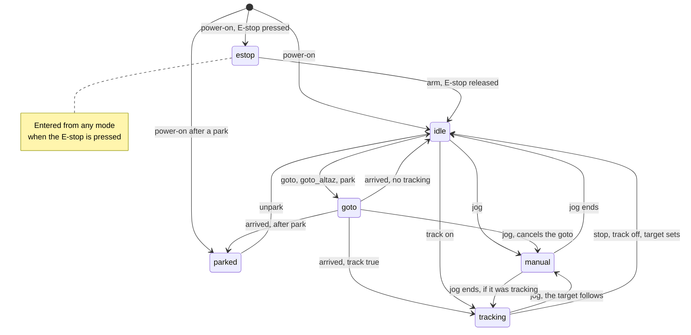
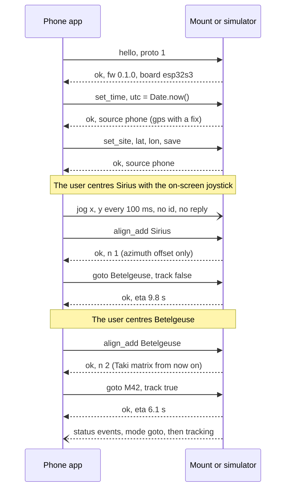

# Protocol (planned)

Status: design notes. Nothing below is implemented yet.

The messages between the mount and its clients: the phone web app, a computer on the
serial console, and test scripts. The mount firmware and the simulator
(`firmware/sim/`, planned) both implement this protocol, with the same code.

## Transports



| Transport | Where | Framing |
| --- | --- | --- |
| WebSocket | `ws://192.168.4.1/ws` on the mount's access point | One JSON object per text frame. |
| Serial | The ESP32 board's UART USB port, 115200 baud | One JSON object per line (`\n`). `\r` is ignored. |
| Simulator | WebSocket on `ws://localhost:8080/ws`, and stdin/stdout | As above: frames on the WebSocket, lines on stdin/stdout. |

- The same handler serves every transport. A command gets the same reply on each.
- On serial, everything the mount writes is a JSON line, including its logs
  (see [`log`](#log)). Lines that do not start with `{` are ignored, so a terminal
  can send an empty line without an error.
- Up to 4 WebSocket clients at once. Each one receives the events; a reply goes
  only to the client that sent the command.
- Largest message: 4 KB. A longer one is rejected with `too_long`.
- HTTP on the same port serves the web app at `/`. Not described here.
- An LX200 subset over TCP (for SkySafari and Stellarium) is planned as a separate
  listener. It translates to the same commands and is not described here.

## Messages



Three kinds, told apart by their first key:

| Kind | Direction | Shape |
| --- | --- | --- |
| Command | client → mount | `{"cmd": "goto", "id": 7, ...arguments}` |
| Reply | mount → client | `{"re": 7, "ok": true, ...result}` or `{"re": 7, "ok": false, "err": "estop", "msg": "..."}` |
| Event | mount → client | `{"ev": "status", ...}` |

- `id` is chosen by the client: an integer, echoed as `re` in the reply. Without an
  `id`, the command is carried out and no reply is sent (used for `jog`).
- Every command with an `id` gets exactly one reply, sent once the command is
  accepted or refused. A long command (a goto) replies at the start; its progress
  shows in [`status`](#status).
- `err` is a code from [Errors](#errors). `msg` is text for people and may change.
- Unknown keys in a command are ignored, so a newer app can talk to an older mount.
  A missing required argument is `bad_arg`.

## Units and conventions

| Quantity | Unit | Notes |
| --- | --- | --- |
| Time | UTC, milliseconds since 1970-01-01 (JavaScript `Date.now()`) | Integer. |
| Right ascension `ra` | hours, 0 ≤ ra < 24 | As Astronomy Engine returns it. |
| Declination `dec` | degrees, −90 to +90 | |
| Altitude `alt` | degrees above the horizon | Includes refraction (below). |
| Azimuth `az` | degrees from north through east, 0 ≤ az < 360 | |
| Latitude `lat`, longitude `lon` | degrees, north and east positive | |
| Elevation `elev` | metres | |
| Speeds | degrees per second | On the sky axis (after the belt reduction). |
| Axis position `steps` | microsteps, signed 32-bit integer | 160 000 per axis turn (below). |

- RA/Dec are **topocentric apparent coordinates of date**. The app applies precession,
  nutation, aberration and, for the Moon, parallax (Astronomy Engine does all four).
  The mount applies none of them.
- The mount converts between RA/Dec and alt/az with its clock and site, and adds
  atmospheric refraction to the altitude (Saemundsson's formula, and Bennett's for the
  inverse, at 10 °C and 1010 hPa).
- Both axes: 200 steps × 1/64 microsteps × 250/20 belt = 160 000 microsteps per turn,
  8.1″ per microstep. Set by `az.steps_per_rev` and `alt.steps_per_rev` in
  [Configuration](#configuration).

## Mount state

### Modes



`stop` also takes `manual` and `goto` to `idle`.

| Mode | Motors | Entered by |
| --- | --- | --- |
| `estop` | Drivers off (by the E-stop contact, not the firmware). | The E-stop pressed, in any mode. At power-on if the E-stop is pressed. |
| `idle` | Holding, not moving. | `arm`, `stop`, a goto that ends without tracking, `unpark`. At power-on. |
| `manual` | Moving from the joystick or `jog`. | A jog from the hand unit or the app. Back to `idle` (or `tracking`, see below) when the jog ends. |
| `goto` | Slewing to a target. | `goto`, `goto_altaz`, `park`. |
| `tracking` | Following the target. | The end of a goto with `track: true`; `track`. |
| `parked` | Holding at the park position; jogs and gotos refused. | The end of `park`. Kept over a reboot. |

- A jog during tracking moves the mount off the target and keeps tracking: the
  target moves with the jog (used to centre an object). The mode shows `manual`
  while the joystick is off centre, then `tracking` again.
- A jog during a goto cancels the goto.
- After the E-stop, the drivers lost their holding torque: the position is
  marked as uncertain (`pos_ok: false`) until an `align_add` or a `sync`.

### Readiness flags

Reported in [`status`](#status). Some commands need them:

| Flag | Meaning | Set by |
| --- | --- | --- |
| `time_ok` | The mount's clock is set. | A GPS time, or `set_time`. |
| `site_ok` | The site is known. | A GPS fix, `set_site`, or a site saved earlier. |
| `aligned` | At least one alignment star. | `align_add`. Cleared by `align_clear`. |
| `pos_ok` | The axis positions are trusted. | Power-on (assumes the tube was level and the steppers did not slip), `align_add`, `sync`. Cleared by the E-stop. |

## Commands

The table lists every command; the sections below give the details.

| Command | Arguments | Needs |
| --- | --- | --- |
| [`hello`](#hello) | `proto` | — |
| [`status`](#status) | — | — |
| [`set_time`](#set_time) | `utc` | — |
| [`set_site`](#set_site) | `lat`, `lon`, `elev`, `save` | — |
| [`arm`](#arm) | — | E-stop released |
| [`stop`](#stop) | — | — |
| [`jog`](#jog) | `x`, `y` | armed, not parked |
| [`goto`](#goto) | `ra`, `dec`, `track` | armed, `time_ok`, `site_ok`, `aligned` |
| [`goto_altaz`](#goto_altaz) | `alt`, `az` | armed, `pos_ok` (`aligned` for `az`) |
| [`track`](#track) | `on` | `time_ok`, `site_ok`, `aligned` |
| [`track_table`](#track_table) | `points` | as `goto` |
| [`align_add`](#align_add) | `ra`, `dec`, `name` | `time_ok`, `site_ok` |
| [`align_clear`](#align_clear) | — | — |
| [`align_list`](#align_list) | — | — |
| [`sync`](#sync) | `ra`, `dec` | `aligned` |
| [`park`](#park) / [`unpark`](#unpark) | — | armed, `pos_ok` |
| [`set_alt_zero`](#set_alt_zero) | — | — |
| [`get_config`](#get_config) / [`set_config`](#set_config) | keys | — |
| [`stream`](#stream) | `hz` | — |

"Armed" means the mode is not `estop`.

### hello

Sent by the client after connecting. The mount answers with what it is.

```json
{"cmd": "hello", "id": 1, "proto": 1}
{"re": 1, "ok": true, "proto": 1, "fw": "0.1.0", "board": "esp32s3", "sim": false}
```

- `proto` is the protocol version. It changes only when a message changes in a way an
  older client would misread; added commands, arguments and status fields keep it.
  If the versions differ, the app shows a warning and carries on.
- `board` is `esp32s3` on the mount and `sim` in the simulator; `sim` is true in
  the simulator.

### status

Without arguments, returns the same fields as the [`status` event](#status-event).
Used on serial, where the event is not sent unless asked for (see
[`stream`](#stream)).

### set_time

```json
{"cmd": "set_time", "id": 2, "utc": 1795300000000}
{"re": 2, "ok": true, "source": "phone"}
```

- The app sends its clock right after `hello`, on every connection.
- A GPS time is used in preference: with a GPS fix, `set_time` is accepted and
  ignored, and the reply says `"source": "gps"`.
- A jump of more than 1 s while tracking is applied at once; the tracking catches up
  through the slew limits.

### set_site

```json
{"cmd": "set_site", "id": 3, "lat": 45.0, "lon": 5.0, "elev": 200, "save": true}
{"re": 3, "ok": true, "source": "phone"}
```

- `elev` is optional (default 0). `save: true` stores the site in flash, so it is
  known at the next power-on.
- A GPS fix is used in preference, as for `set_time`. Town-level accuracy is enough:
  the alignment absorbs a site error of a few kilometres.

### arm

Re-arms the mount after the E-stop has been released.

- Refused with `estop` while the E-stop is still pressed.
- The mode goes from `estop` to `idle`, the motors hold. `pos_ok` stays false.

### stop

Stops every motion with the configured deceleration and ends tracking. The mode
becomes `idle`. Accepted in every mode (in `estop` and `parked` it does nothing).
The app's stop button sends it; button 1 of the hand unit does the same.

### jog

```json
{"cmd": "jog", "x": 0.5, "y": -1.0}
```

- `x` turns the azimuth axis (positive: east, clockwise seen from above), `y` the
  altitude axis (positive: up). Each from −1 to 1; the speed is
  `jog.max_speed × |value|²` (fine control near the centre).
- **Dead-man**: a jog lasts 200 ms. The app repeats it every 100 ms while the finger
  is on the joystick; when the messages stop, the mount decelerates to a stop. A jog
  of `0, 0` stops at once.
- Sent without an `id`: no reply. Errors are not reported (the status shows the mode).
- The hand unit has priority: while its joystick is off centre, jogs from the app are
  ignored.
- A WebSocket client that disconnects ends its jog at once. Gotos and tracking go on.

### goto

```json
{"cmd": "goto", "id": 4, "ra": 5.5881, "dec": -5.391, "track": true}
{"re": 4, "ok": true, "alt": 23.4, "az": 162.0, "eta": 14.2}
```

- Slews to the target, then tracks it if `track` is true (the default).
- The reply gives the target's alt/az now and the estimated slew time in seconds.
- Refused with `below_limit` if the target is below `alt.min`, and with `not_ready`
  if a flag in the table above is missing (`msg` says which).
- A target that sets below `alt.min` while tracking stops the tracking (mode `idle`)
  with a `log` event at level `warn`.

### goto_altaz

```json
{"cmd": "goto_altaz", "id": 5, "alt": 45, "az": 180}
```

- Slews to fixed alt/az, without tracking. Either may be left out to move one axis.
- Before the first alignment star, `az` is meaningless (north is unknown) and is
  refused with `not_ready`; `alt` alone works from the level position at power-on.

### track

`{"cmd": "track", "on": true}` starts tracking the last goto target, or the current
position if there was none. `on: false` stops tracking and holds (mode `idle`).

### track_table

For the Moon and planets, whose RA/Dec change during a night: the app sends a table
of positions, and the mount interpolates.

```json
{"cmd": "track_table", "id": 6, "points": [
  [1795300000000, 3.1234, 17.512],
  [1795300600000, 3.1462, 17.598],
  [1795301200000, 3.1690, 17.683]
]}
```

- Each point is `[utc, ra, dec]`, in time order, at most 64 points (10-minute steps
  cover 10 hours and fit in 4 KB).
- The mount interpolates RA/Dec with a cubic through the four nearest points,
  then converts to alt/az as for a fixed target.
- It then behaves as `goto` with `track: true`. After the last point, tracking stops,
  as for a target that sets. The app sends a new table before then (it can do so
  while tracking; the new table replaces the old one without a new slew).

### align_add

The user centres a star with the joystick, then the app sends what it is:

```json
{"cmd": "align_add", "id": 8, "ra": 6.7525, "dec": -16.716, "name": "Sirius"}
{"re": 8, "ok": true, "n": 2, "rms": 0.07}
```

- The mount pairs the star's alt/az (from its clock and site) with the axis
  positions now.
- One star: an azimuth offset only, assuming a level base.
- Two stars or more: Taki's matrix method (absorbs a base that is not level and an
  unknown north). With three or more, the best fit; `rms` is the residual in degrees.
- At most 6 stars. A seventh replaces the oldest.
- Sets `aligned` and `pos_ok`. Saved in flash, and restored at power-on only after a
  [`park`](#park), when the axis positions are known.

### align_clear

Removes every alignment star. `aligned` becomes false.

### align_list

```json
{"re": 9, "ok": true, "stars": [
  {"name": "Sirius", "ra": 6.7525, "dec": -16.716, "err": 0.05},
  {"name": "Betelgeuse", "ra": 5.9195, "dec": 7.407, "err": 0.08}
]}
```

`err` is each star's residual in degrees (0 with fewer than three stars).

### sync

`{"cmd": "sync", "id": 10, "ra": 5.5881, "dec": -5.391}`: "the object now centred is
this one". It corrects the model near that point (an offset added to the
alignment, which fades away from it), without adding an alignment star. Used after
a goto that landed slightly off. Sets `pos_ok`.

### park

Slews to the park position (`park.alt`, `park.az` in [Configuration](#configuration),
axis coordinates), then turns tracking off and holds. The mode `parked` is saved in
flash: at the next power-on, the mount starts parked with `pos_ok` true, and the
alignment is kept.

### unpark

Leaves `parked` for `idle`.

### set_alt_zero

"The tube is level now": sets the altitude axis position to 0°. For a mount that
was not level at power-on. Clears the alignment stars, sets `pos_ok`.

### get_config

```json
{"cmd": "get_config", "id": 11}
{"re": 11, "ok": true, "config": {"az.steps_per_rev": 160000, "alt.min": 0, ...}}
```

`{"cmd": "get_config", "id": 11, "keys": ["alt.min"]}` returns only those keys.

### set_config

```json
{"cmd": "set_config", "id": 12, "config": {"alt.min": 5, "slew.speed": 2.5}}
{"re": 12, "ok": true}
```

Saved in flash. All keys are checked before any is changed: one bad key or value
refuses the whole command with `bad_arg`.

### stream

`{"cmd": "stream", "id": 13, "hz": 10}` sends the `status` event on this connection at
`hz` (0 to stop, at most 10). WebSocket clients get 10 Hz from the start; serial and
stdin/stdout get 0, so a terminal is not flooded.

## Events

### status event

Sent at 10 Hz (see [`stream`](#stream)), and at once on a change of mode.

```json
{"ev": "status",
 "utc": 1795300000123, "mode": "tracking",
 "time_ok": true, "site_ok": true, "aligned": true, "pos_ok": true,
 "time_src": "gps", "site_src": "saved",
 "site": {"lat": 45.0, "lon": 5.0, "elev": 200},
 "gps": {"fix": true, "sats": 7},
 "pos": {"ra": 5.5880, "dec": -5.390, "alt": 23.41, "az": 162.03},
 "target": {"ra": 5.5881, "dec": -5.391, "alt": 23.40, "az": 162.04},
 "axes": {"az":  {"steps": 72013, "speed": 0.0041},
          "alt": {"steps": 10404, "speed": 0.0019}},
 "estop": false, "hand": false}
```

| Field | Meaning |
| --- | --- |
| `utc` | The mount's clock. |
| `mode` | See [Modes](#modes). |
| `time_src`, `site_src` | `gps`, `phone`, `saved` or `none`. |
| `gps` | `fix`, `sats`; `null` when no NMEA is received. |
| `pos` | Where the tube points, from the axis positions through the alignment. `ra`/`dec` are `null` without `time_ok`, `site_ok` and `aligned`; `az` is `null` before alignment. |
| `target` | The goto or tracking target; `null` without one. |
| `axes` | Each axis's position in microsteps and its speed in °/s (signed). Raw: no alignment. |
| `estop` | The E-stop is pressed (DRV_EN high while the firmware drives it low). |
| `hand` | The hand unit's joystick is off centre (the app's jogs are ignored). |

### log

```json
{"ev": "log", "level": "warn", "msg": "target below alt.min, tracking stopped"}
```

`level` is `debug`, `info`, `warn` or `error`. `debug` is sent only on serial and
stdin/stdout.

## Errors

| `err` | Meaning |
| --- | --- |
| `bad_json` | The message is not a JSON object. Reply with `re: null`. |
| `too_long` | Longer than 4 KB. Reply with `re: null`. |
| `unknown_cmd` | No such command (for example a simulator command sent to the mount). |
| `bad_arg` | An argument missing, of the wrong type or out of range. `msg` names it. |
| `estop` | The E-stop is pressed, or the mount is not re-armed (`arm`). |
| `parked` | Refused while parked: `unpark` first. |
| `not_ready` | A readiness flag is missing. `msg` names it. |
| `below_limit` | The target is below `alt.min` or above `alt.max`. |

## Configuration

Keys for `get_config` / `set_config`, saved in flash (NVS). Default values are
starting points, to be checked on the mount.

| Key | Default | Meaning |
| --- | --- | --- |
| `az.steps_per_rev`, `alt.steps_per_rev` | 160000 | Microsteps per turn of the axis. |
| `az.reverse`, `alt.reverse` | false | Swap the motor direction. |
| `alt.min`, `alt.max` | 0, 90 | Altitude limits in degrees. Gotos and jogs stop there. |
| `slew.speed` | 3 | Goto speed, °/s. |
| `slew.accel` | 2 | Acceleration for gotos and stops, °/s². |
| `jog.max_speed` | 3 | Jog speed at full deflection, °/s. |
| `park.alt`, `park.az` | 0, 0 | Park position in axis degrees (from the power-on position). |
| `track.gain` | 1 | k in "speed = predicted rate + k × position error" (1/s). |
| `wifi.ssid`, `wifi.password` | `star-track`, (set at first boot) | The access point. Changes apply at the next power-on. |

## Simulator commands

The simulator adds commands, all starting with `sim_`. The mount answers them with
`unknown_cmd`.

| Command | Arguments | Effect |
| --- | --- | --- |
| `sim_clock` | `rate`, `utc` | Clock speed (0 = paused, 1, 10, 1000) and optionally a new true UTC (the time the GPS gives). |
| `sim_run` | `seconds` | Runs the mount for that much simulated time at once, then replies. For scripted tests with a paused clock. |
| `sim_estop` | `pressed` | Presses or releases the E-stop. |
| `sim_hand` | `x`, `y`, `sw`, `buttons` | Sets the hand unit's joystick (−1 to 1) and buttons (array of 3 booleans). |
| `sim_gps` | `on`, `fix`, `lat`, `lon`, `elev`, `sats` | `on: false` stops the NMEA sentences. `fix: false` sends sentences without a fix. `lat`, `lon` are also the true site of the simulated sky. |
| `sim_mount` | `tilt`, `tilt_az`, `north`, `alt_zero` | The base's tilt (degrees, towards azimuth `tilt_az`), where north is in axis degrees, and the tube's altitude at axis 0. For alignment tests. |
| `sim_fault` | `axis`, `slip` | Adds `slip` microsteps to an axis (`az` or `alt`) without the firmware knowing (a stalled or slipping motor). |
| `sim_point` | `ra`, `dec` or `alt`, `az` | Points the tube there, as if the user had centred it with the joystick (the step counters follow). |
| `sim_truth` | — | Where the tube really points (`alt`, `az`, `ra`, `dec`), the true UTC, the LEDs and whether the drivers are on. |

- The simulator's clock drives everything, including the status rate: at ×1000,
  `stream` at 10 Hz sends 10 000 events per second of real time.
- The simulator's build, options and tests are described in
  [`firmware/sim/`](../firmware/sim/).

## Example session

The app, after connecting to the mount's access point (numbers for illustration
only):



The same session as raw messages (`>` sent, `<` received, status events left
out):

```
> {"cmd":"hello","id":1,"proto":1}
< {"re":1,"ok":true,"proto":1,"fw":"0.1.0","board":"esp32s3","sim":false}
> {"cmd":"set_time","id":2,"utc":1795300000000}
< {"re":2,"ok":true,"source":"phone"}
> {"cmd":"set_site","id":3,"lat":45.0,"lon":5.0,"save":true}
< {"re":3,"ok":true,"source":"phone"}
  (the user jogs to Sirius with the joystick)
> {"cmd":"align_add","id":4,"ra":6.7525,"dec":-16.716,"name":"Sirius"}
< {"re":4,"ok":true,"n":1,"rms":0}
> {"cmd":"goto","id":5,"ra":5.9195,"dec":7.407,"track":false}
< {"re":5,"ok":true,"alt":38.2,"az":171.5,"eta":9.8}
  (the user centres Betelgeuse)
> {"cmd":"align_add","id":6,"ra":5.9195,"dec":7.407,"name":"Betelgeuse"}
< {"re":6,"ok":true,"n":2,"rms":0}
> {"cmd":"goto","id":7,"ra":5.5881,"dec":-5.391}
< {"re":7,"ok":true,"alt":23.4,"az":162.0,"eta":6.1}
< {"ev":"status",...,"mode":"tracking",...}
```
